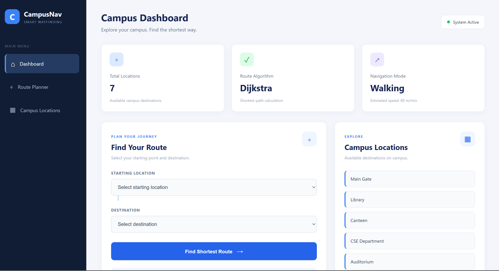
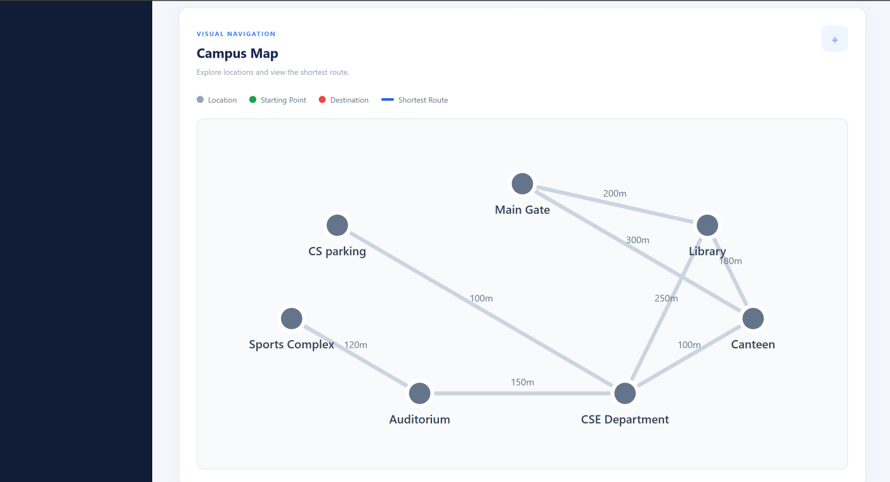
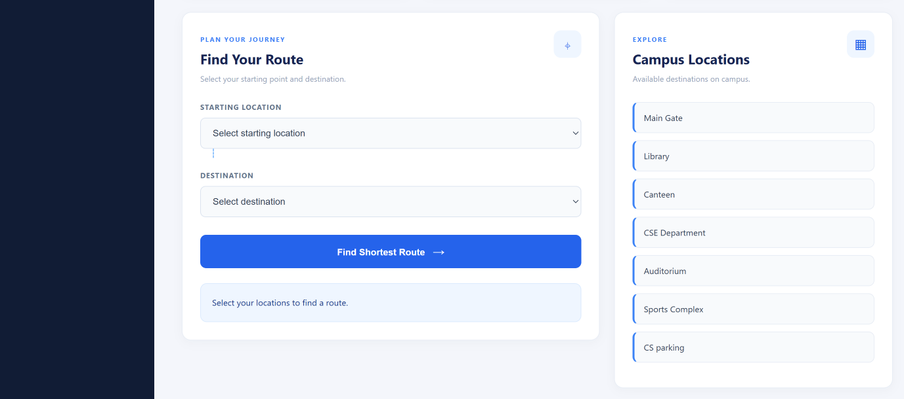
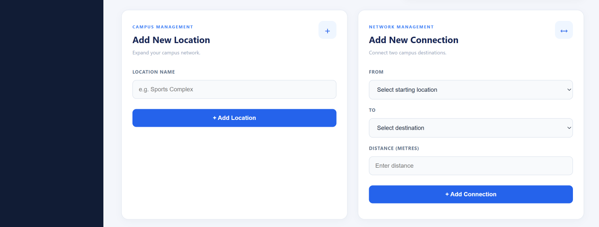

# Campus Navigation System

A full-stack campus navigation application built using **C++**, **Crow**, **HTML**, **CSS**, and **JavaScript**. The system helps users explore campus locations, manage connections between them, and find the shortest route using Dijkstra's shortest-path algorithm.

## Features

- **Shortest Path Navigation:** Finds the minimum-distance route between two campus locations using Dijkstra's algorithm.
- **Interactive Campus Map:** Displays campus locations and highlights the selected route.
- **Location Management:** Add new campus locations through the web dashboard.
- **Connection Management:** Add connections between locations and specify their distances.
- **Persistent Data Storage:** Saves campus locations and connections in `data/campus_data.txt`, preserving updates after the backend restarts.
- **REST API:** Connects the frontend to the C++ backend through HTTP requests.
- **Responsive Interface:** Provides a user-friendly dashboard for campus navigation.

## Technologies Used

| Component | Technology |
|---|---|
| Backend | C++ (C++17) |
| Web Framework | Crow |
| Networking | Standalone Asio |
| Frontend | HTML, CSS, JavaScript |
| Build System | CMake |
| Algorithm | Dijkstra's Shortest Path Algorithm |
| Data Structure | Weighted graph using an adjacency list |
| Data Storage | File handling in C++ |

## Application Screenshots

### Dashboard


### Campus Map


### Application View


### Update Functionality


## How It Works

The campus is represented as an **undirected weighted graph**:

- Each campus location represents a vertex.
- Each connection between locations represents an edge.
- The distance between locations represents the edge weight.
- An adjacency list stores the graph.
- A priority queue helps Dijkstra's algorithm select the next closest location.

The backend exposes REST API endpoints. The frontend uses these endpoints to retrieve campus information, add locations, create connections, and request shortest routes.

Campus data is stored in `data/campus_data.txt`, so locations and connections added through the dashboard remain available after restarting the backend.

## Project Structure

```text
Campus-Navigation/
├── backend/
│   ├── crow/                 # Crow framework header files
│   ├── crow.h
│   ├── main.cpp              # REST API routes and server
│   ├── navigation.cpp        # Graph and shortest-path implementation
│   └── navigation.h          # Graph declarations
├── frontend/
│   ├── index.html            # Web dashboard
│   ├── script.js             # Frontend functionality and API integration
│   └── style.css             # Dashboard styling
├── data/
│   └── campus_data.txt       # Persistent campus map data
├── screenshots/              # Application screenshots
├── CMakeLists.txt
├── .gitignore
└── README.md
```

## Sample Campus Data

The initial campus graph contains seven locations:

- Main Gate
- Library
- Canteen
- CSE Department
- Auditorium
- Sports Complex
- CS Parking

The starter graph contains eight connections, each assigned a distance in metres. Users can add further locations and connections through the web interface.

## Installation and Setup

### Prerequisites

Install the following:

- C++ compiler supporting C++17
- CMake
- MinGW-w64 (MSYS2 UCRT64 is used for development on Windows)
- Python 3
- Standalone Asio

The Crow framework headers are included in the `backend/crow/` directory.

If using MSYS2 UCRT64, install Asio from the **MSYS2 UCRT64** terminal:

```bash
pacman -S mingw-w64-ucrt-x86_64-asio
```

### 1. Clone the Repository

```bash
git clone https://github.com/aadityavasishtag-arch/Campus-Navigation.git
cd Campus-Navigation
```

### 2. Build the Backend

From the project root, configure and build the application:

```bash
cmake -S . -B build
cmake --build build
```

### 3. Start the Backend Server

In **PowerShell**, from the project root, run:

```powershell
.\build\campus_backend.exe
```

The backend server runs at:

```text
http://localhost:18080
```

Keep this terminal open while using the application.

### 4. Start the Frontend

Open a **second PowerShell terminal**. From the project root, run:

```powershell
cd frontend
py -m http.server 5500
```

Open the application in your browser:

```text
http://localhost:5500
```

Keep both terminals running: one for the backend and one for the frontend server.

## REST API Endpoints

The backend exposes the following endpoints:

| Method | Endpoint | Description |
|---|---|---|
| GET | `/locations` | Retrieves all campus locations |
| POST | `/locations` | Adds a new campus location |
| GET | `/connections` | Retrieves campus connections |
| POST | `/connections` | Adds a connection between locations |
| GET | `/route` | Finds the shortest route between two campus locations |

The POST endpoints accept JSON request bodies. The route endpoint accepts source and destination query parameters.

## Algorithm Used: Dijkstra's Shortest Path

Dijkstra's algorithm finds the minimum-distance path between a source and destination in a graph with non-negative edge weights.

**Working:**

1. Initialize the source vertex with distance zero and all other vertices with infinity.
2. Select the unvisited vertex with the smallest tentative distance using a priority queue.
3. Examine its adjacent vertices and update their distances when a shorter path is found.
4. Repeat until the destination is reached or no reachable vertices remain.
5. Reconstruct the shortest path using the recorded predecessor information.

**Time Complexity:** With an adjacency list and a priority queue, the time complexity is approximately **O((V + E) log V)**, where **V** is the number of vertices and **E** is the number of edges.

## Future Enhancements

- Deploy the application online for public access.
- Add support for editing and deleting locations and connections.
- Introduce accessibility-aware route options.
- Improve the map with real campus coordinates and more detailed layouts.
- Add estimated walking times and additional navigation features.

## Author

**Aditya G**

GitHub: [aadityavasishtag-arch](https://github.com/aadityavasishtag-arch)

---

*Campus Navigation is a data structures and algorithms project extended into a full-stack web application.*
